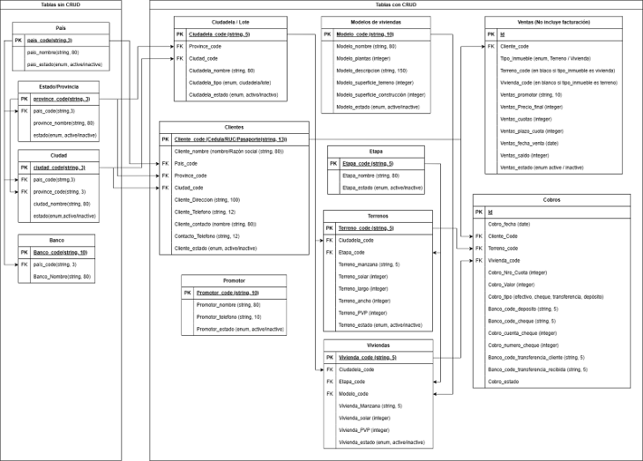
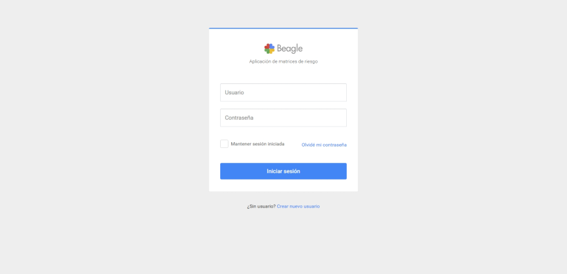
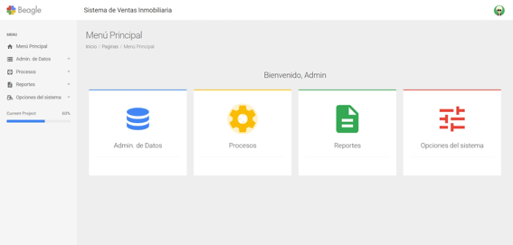
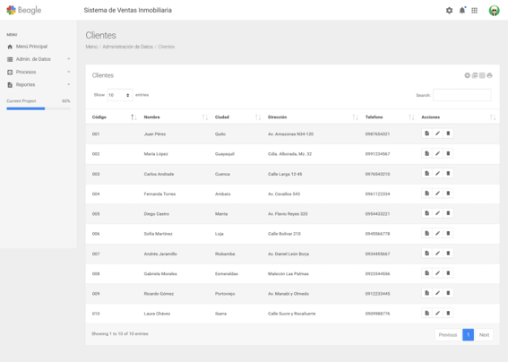
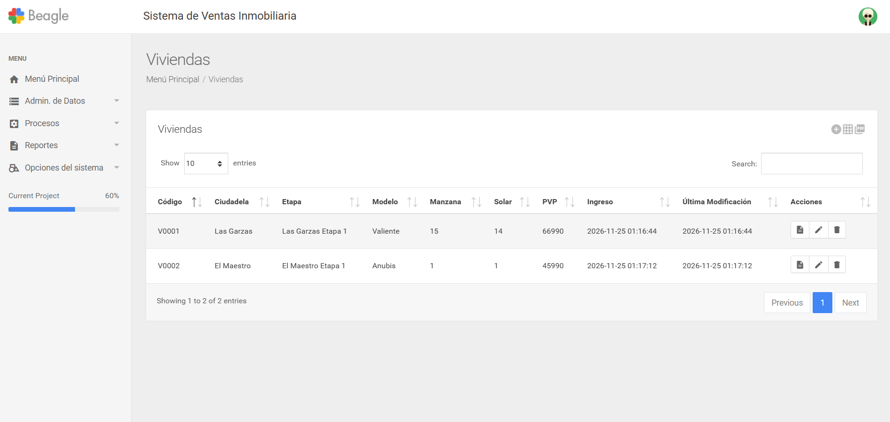
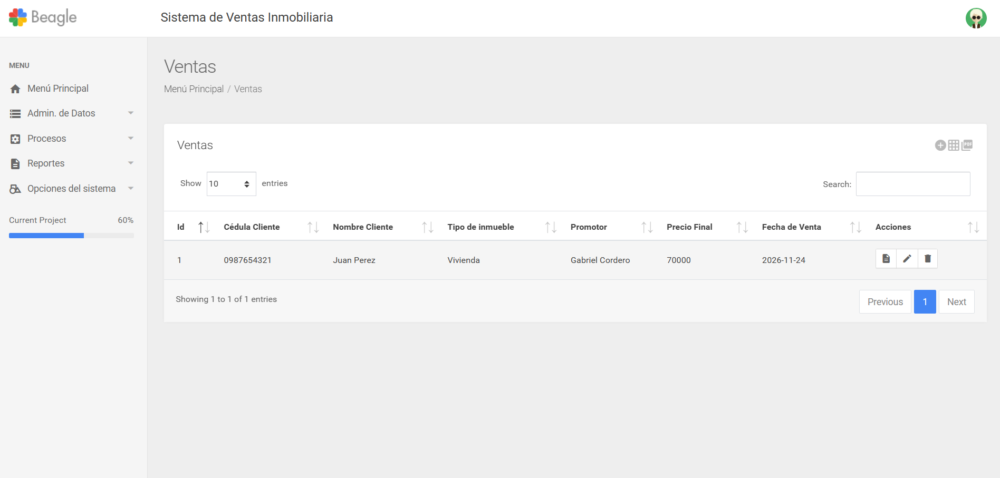
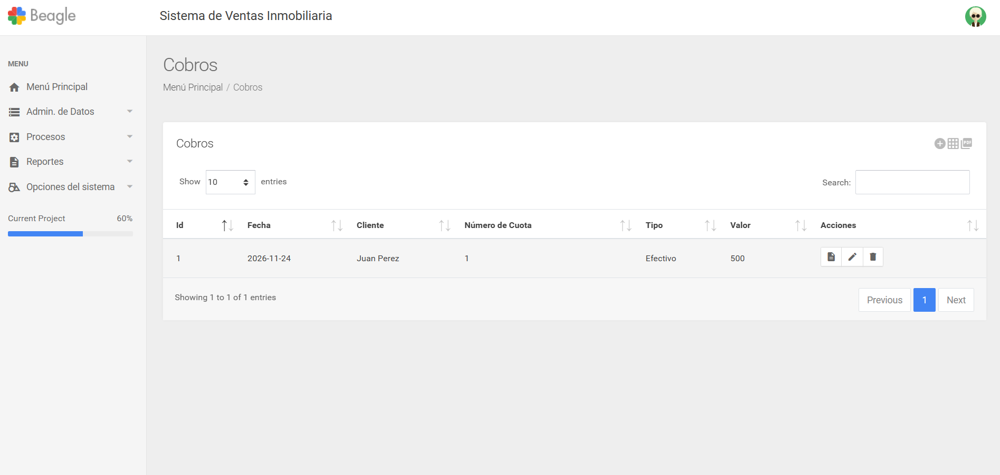
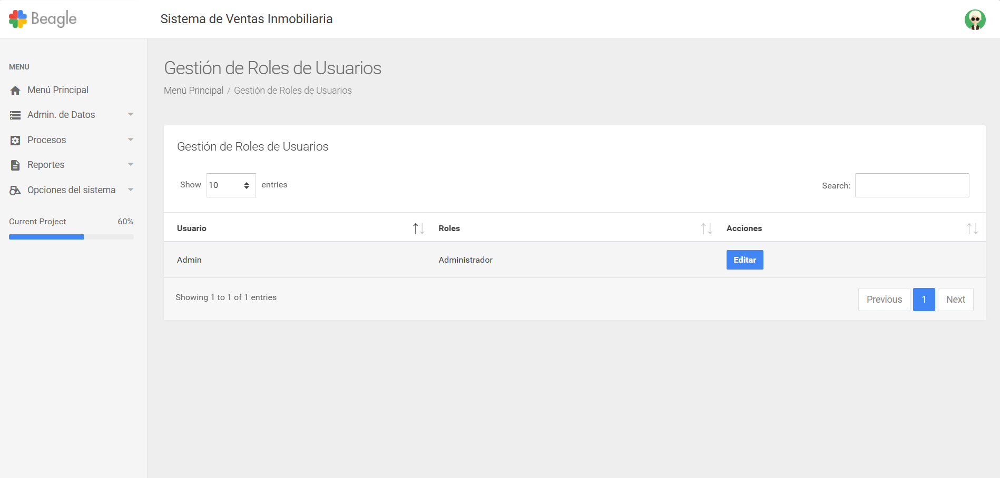

# Sistema de Gestión de Ventas Inmobiliarias

Aplicación web desarrollada para administrar operaciones comerciales de proyectos inmobiliarios, incluyendo clientes, promotores, terrenos, viviendas, ventas y cobros.

El sistema permite centralizar la información de los proyectos inmobiliarios y gestionar procesos relacionados con la comercialización de terrenos y viviendas, así como el seguimiento de los pagos realizados por los clientes.

## Descripción general

El sistema fue diseñado para organizar los procesos administrativos y comerciales de una empresa inmobiliaria, integrando la gestión de sus proyectos, clientes y operaciones de venta en una sola plataforma.

Su estructura contempla módulos de administración de datos, procesos operativos y reportes para facilitar el seguimiento de las ventas y la cartera de clientes.

## Funcionalidades principales

### 1. Administración de proyectos inmobiliarios

Gestión de la estructura y disponibilidad de los proyectos inmobiliarios:

- Administración de ciudadelas o urbanizaciones.
- Gestión de etapas.
- Registro y administración de terrenos.
- Gestión de modelos de viviendas.
- Administración de viviendas.

### 2. Gestión de clientes y promotores

- Registro y administración de clientes.
- Consulta y actualización de información de clientes.
- Gestión de promotores inmobiliarios.
- Administración de información relacionada con las operaciones comerciales.

### 3. Gestión de ventas

- Registro de operaciones de venta.
- Asociación de clientes con sus respectivas ventas.
- Relación de ventas con terrenos y viviendas.
- Consulta y administración de información comercial.

### 4. Gestión de cobros

- Registro y administración de cobros.
- Seguimiento de pagos relacionados con las ventas.
- Consulta de información de cobros.
- Gestión de cierres diarios de cobros.
- Reverso de cierres diarios.

### 5. Reportes administrativos y financieros

El sistema contempla reportes orientados al seguimiento de las operaciones comerciales y la cartera:

- Cuentas por cobrar por cliente.
- Ventas por promotor.
- Total de ventas mensuales.
- Maduración de cartera.

**Nota:** Los reportes de Total de ventas mensuales y Maduración de cartera se encuentran en desarrollo.
### 6. Administración del sistema

- Gestión de usuarios.
- Administración de roles y permisos.
- Asignación de roles a usuarios.
- Edición de información de cuentas.
- Cambio de contraseña.

## Tecnologías utilizadas

| Tecnología | Aplicación |
|---|---|
| PHP / Laravel | Desarrollo del backend y lógica de negocio |
| Bootstrap | Diseño de interfaces y componentes visuales |
| MySQL | Gestión de la base de datos relacional |
| JavaScript | Interactividad del lado del cliente |

## Responsabilidades de desarrollo

Desarrollo individual del sistema, incluyendo:

- Análisis y desarrollo de módulos funcionales.
- Diseño e implementación de formularios administrativos.
- Desarrollo de operaciones CRUD.
- Diseño y gestión de relaciones entre entidades de la base de datos.
- Implementación de módulos de clientes, promotores y proyectos inmobiliarios.
- Desarrollo de procesos de ventas y cobros.
- Implementación de cierres diarios y reversos de cierres.
- Desarrollo de administración de usuarios, roles y permisos.
- Elaboración de funcionalidades de consulta y reportes.

## Organización funcional

El sistema está organizado en tres áreas principales:

| Área | Módulos |
|---|---|
| Administración de datos | Clientes, promotores, ventas, cobros, ciudadelas, etapas, terrenos, modelos de viviendas y viviendas |
| Procesos | Cierre diario de cobros y reverso de cierre |
| Reportes | Cuentas por cobrar, ventas por promotor, ventas mensuales y maduración de cartera |

## Modelo de datos

El proyecto cuenta con un modelo entidad-relación que representa la estructura de información y las relaciones entre los principales componentes del sistema.

`docs/database/diagrama-entidad-relacion.png`

## Capturas de pantalla

Las siguientes imágenes permiten conocer la interfaz y algunos módulos principales de la aplicación.

### Inicio de sesión y menú principal

### Administración de clientes

### Administración de proyectos inmobiliarios

### Gestión de ventas y cobros

### Administración de usuarios y permisos

## Estado del proyecto

| Módulo | Estado |
|---|---|
| Administración de clientes | Implementado |
| Administración de promotores | Implementado |
| Gestión de ciudadelas y etapas | Implementado |
| Gestión de terrenos y viviendas | Implementado |
| Gestión de modelos de viviendas | Implementado |
| Gestión de ventas | Implementado |
| Gestión de cobros | Implementado |
| Cierre diario de cobros | Implementado |
| Reverso de cierre | Implementado |
| Reportes administrativos y financieros | En desarrollo |

## Consideraciones

Este repositorio tiene fines demostrativos y documentales. El código fuente original no se encuentra publicado, debido a que corresponde a un proyecto de carácter comercial.

Las capturas de pantalla y diagramas incorporados se encuentran debidamente anonimizados y no contienen información confidencial de clientes ni de la empresa.

---

**Desarrollo:** Individual  
**Tipo de aplicación:** Sistema web de gestión inmobiliaria  
**Backend:** Laravel  
**Base de datos:** MySQL